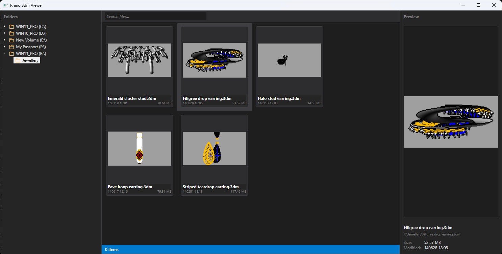
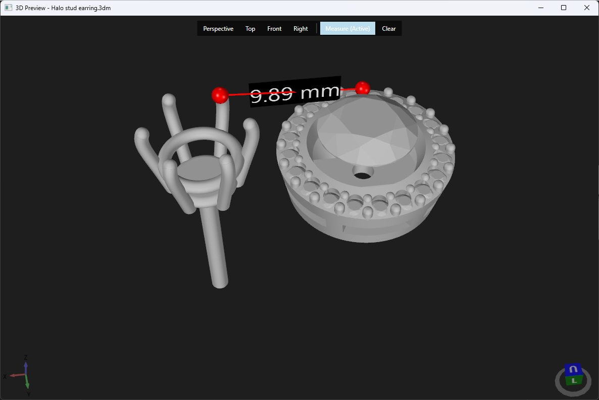

# RhinoThumbs.NET: fast browser and 3D viewer for Rhino `.3dm` files

Browse folders full of Rhino 3D (`.3dm`) files as a grid of thumbnails, search them, and open any model in an interactive 3D view to rotate it and measure it. You don't need Rhino installed or a Rhino license.

Windows File Explorer shows `.3dm` files as blank icons unless Rhino is installed. This app reads the preview image every `.3dm` file carries inside it, so you can find the right model by sight, including on shared network drives.





**Who is it for?**
- Jewellery, product and industrial designers with hundreds of `.3dm` files spread over folders and network shares.
- Workshop, production and sales staff who need to look at a model or check a dimension but don't have a Rhino seat.
- Anyone who receives `.3dm` files and just wants to see what is inside.

Free and open source ([MIT](LICENSE)). Windows 10 and 11, 64-bit.

## Download

Get `Rhino3dmViewer-win-x64.zip` from the [latest release](https://github.com/kartikddoshi/Rhino3dmViewer/releases/latest), unzip it anywhere and run `RhinoThumbs.NET.exe`. Keep the other files from the zip next to it. There is nothing else to install.

Windows may show a SmartScreen warning the first time because the app is not code-signed: choose **More info**, then **Run anyway**.

> **Getting the code:** openNURBS is included as a git submodule, so clone with
> `git clone --recursive https://github.com/kartikddoshi/Rhino3dmViewer.git`
> (or run `git submodule update --init` in an existing clone). A prebuilt
> `ThumbnailExtractorCLI.exe` is already in `Tools/`, so you only need the submodule
> if you want to rebuild the native extractor.

## ✨ Features

### Comprehensive File Navigation
*   **Split-View UI**: Built with WPF and CommunityToolkit.Mvvm, featuring a responsive dark-mode layout.
*   **Network Drive Support**: Seamlessly browses local drives as well as connected AND disconnected Mapped Network Drives (attempts automatic reconnection on expansion).
*   **Recursive Background Search**: An instant search bar that filters the current folder or recursively traverses subdirectories in a background thread to find matching `.3dm` files without freezing the app.

### 3D Capabilities
*   **Native Thumbnail Extraction**: Uses a bundled, standalone C++ CLI tool (built with OpenNURBS) to instantly decompress and extract embedded `ON_WindowsBitmap` previews from `.3dm` files.
*   **Interactive 3D Viewer**: Double-click any `.3dm` thumbnail to open a fully hardware-accelerated 3D window (powered by `HelixToolkit.Wpf` and `Rhino3dm`).
    *   **Controls**: Supports Orbit (Right-Click Drag), Pan (Shift+Right-Click Drag), and Zoom (Scroll).
    *   **Viewports**: Dedicated toolbar buttons to snap to Orthographic CAD views (`Top`, `Front`, `Right`) or `Perspective`.
    *   **Measurement Tool**: Advanced 3D raycasting allows you to click any two points directly on the 3D geometry to calculate precise mathematical distances in millimeters.

### Contextual File Operations
*   **Native Copying**: Right-click to copy files into your clipboard (can be pasted directly into Windows Explorer).
*   **Quick Open**: Right-click to "Open in Explorer" to jump straight to the directory of a file or folder.
*   **7-Zip Compression**: Right-click to compress any `.3dm` file or folder into a `.7z` archive using the bundled `7za.exe` (no separate 7-Zip install needed).
*   **Clean Metadata**: Displays file name, date modified, and file size cleanly below every thumbnail.

---

## 🛠 Prerequisites

*   **Windows 10 or 11** (x64)
*   **.NET 10.0 SDK** (for building the UI)
*   **Visual Studio 2022** (with "Desktop development with C++" workload for building the native extractor)
*   **CMake** (3.20 or higher)

## 📁 Project Structure

*   `RhinoThumbs.NET.csproj`: Main WPF application project (C#).
    *   `/ViewModels` & `/Views`: MVVM frontend logic.
    *   `/Services`: Background extraction and `Rhino3dm` native meshing logic.
*   `native_src/`: Source code for the `ThumbnailExtractorCLI` tool (C++).
    *   This is a standalone CMake project that links against OpenNURBS.
    *   *Note: openNURBS is a git submodule at `native_src/3rdparty/opennurbs`; run `git submodule update --init` before building it.*

---

## 🚀 Build Instructions

### 1. Building the Native Extractor (C++)
If you need to recompile the native `ThumbnailExtractorCLI.exe`:
```powershell
cd native_src
cmake -B build
cmake --build build --config Release
```
*Copy the resulting executable into the `Tools/` directory of the main .NET project.*

### 2. Building the WPF Application (.NET)
1. Open `RhinoThumbs.NET.sln` in Visual Studio 2022 or use the .NET CLI.
2. Run `dotnet build`. The process will automatically copy the `Tools/ThumbnailExtractorCLI.exe` alongside your compiled assembly.
3. Run `dotnet run` to launch the application.

### 3. Publishing a Standalone Release
To create a complete, self-contained single-file `.exe` that bundles the .NET runtime and external C++ dependencies:
```powershell
dotnet publish -c Release -r win-x64 --self-contained true -p:PublishSingleFile=true -p:IncludeNativeLibrariesForSelfExtract=true
```
The output can be safely zipped and distributed to non-developers.

---

## 🔧 Troubleshooting

*   **No Thumbnails**: 
    *   Ensure `ThumbnailExtractorCLI.exe` is physically present in the same directory as the main executable.
    *   Ensure the `.3dm` files were saved in Rhino with "Save Small" **unchecked** (so a preview image exists).
*   **"7-Zip component is missing"**:
    *   `7za.exe` must sit next to the app's `.exe` (the build copies it there from `Tools/`).
*   **3D Viewer is Blank**:
    *   Some very large or complex NURBS objects without pre-computed render meshes might fail to display. The application attempts to use existing render meshes to maintain speed.

---

## License

MIT, see [LICENSE](LICENSE). Bundled and referenced components keep their own licenses: see [THIRD_PARTY_NOTICES.md](THIRD_PARTY_NOTICES.md). Rhino is a trademark of Robert McNeel & Associates; this project is not affiliated with McNeel.
